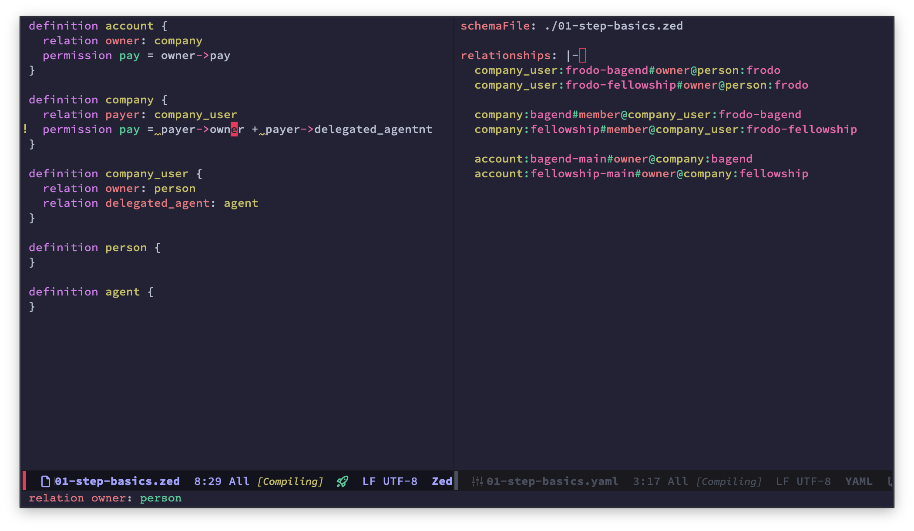

# Emacs mode for SpiceDB .zed files



## zed-mode 

- Syntax highlighting
- Indentation
- Wires up to the `spicedb lsp` LSP server by default, through `eglot`.
- `C-c C-c` runs `zed validate` which both validates the schema and
  evaulates `<file>.yaml` with relationships and assertions.
- `zed-tuples-mode` (in `zed-tuples.el`): a minor mode that highlights
  SpiceDB relationship tuples, including caveats and expirations, in
  any buffer, e.g. `zed validate` YAML files:

  ```elisp
  (require 'zed-tuples)
  (add-hook 'yaml-mode-hook #'zed-tuples-mode)
  ```
## zed-tuples-mode 

Minor mode which gives syntax highlighting of zed tuples in any major
mode, e.g. in [yaml-mode](https://github.com/yoshiki/yaml-mode).

```text
(require 'zed-tuples)
(add-hook 'yaml-mode-hook #'zed-tuples-mode)
```

## AI policy

AI may bed when coding. All code comitted must be understood by the
committer.
